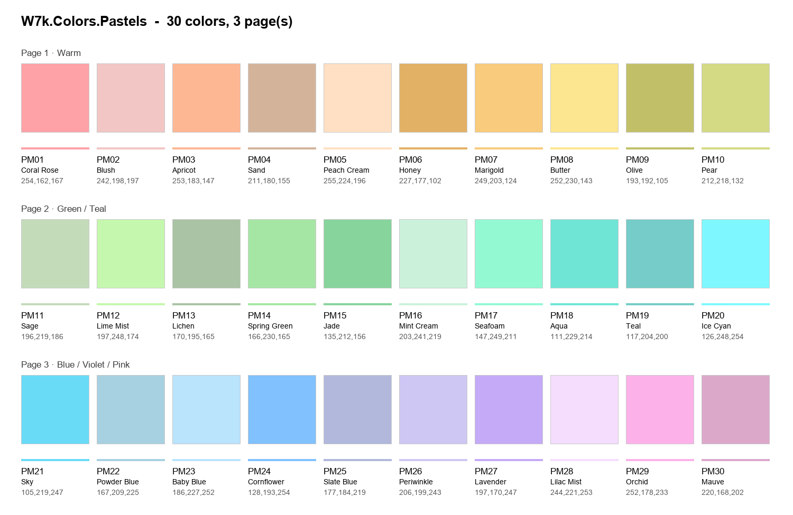
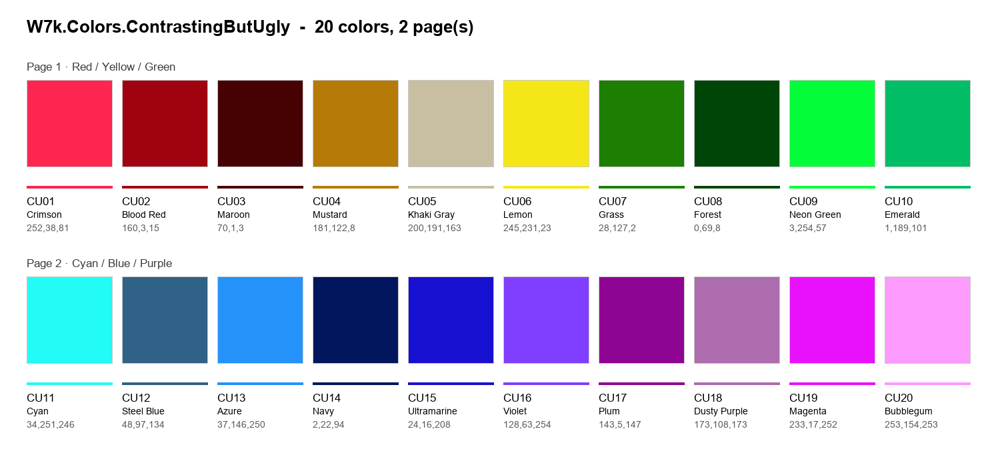
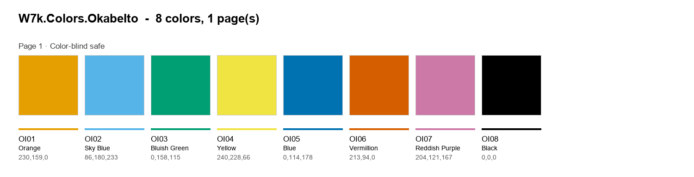
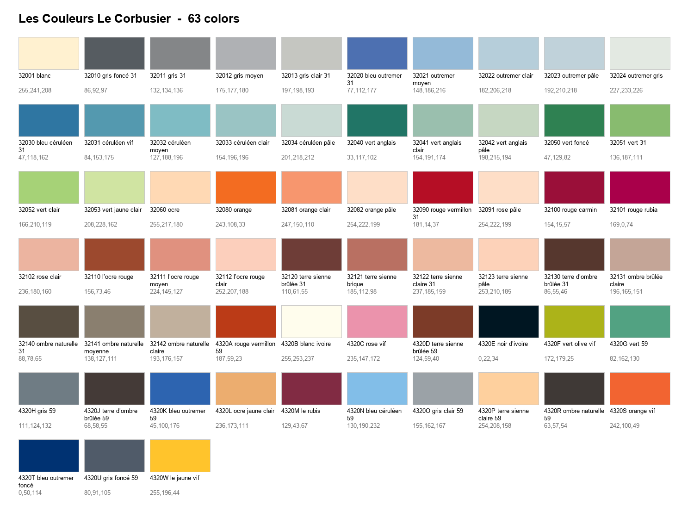
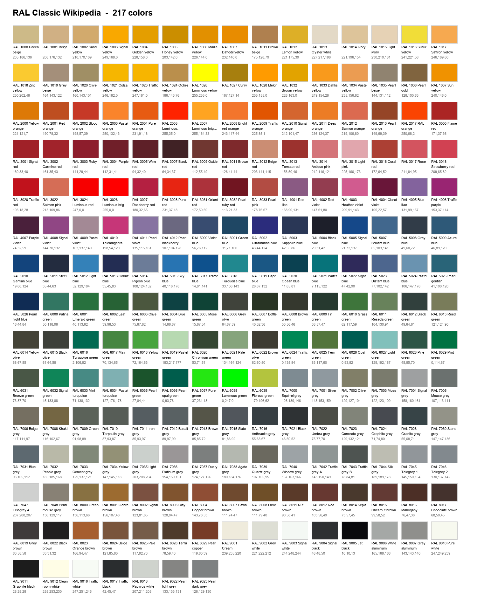
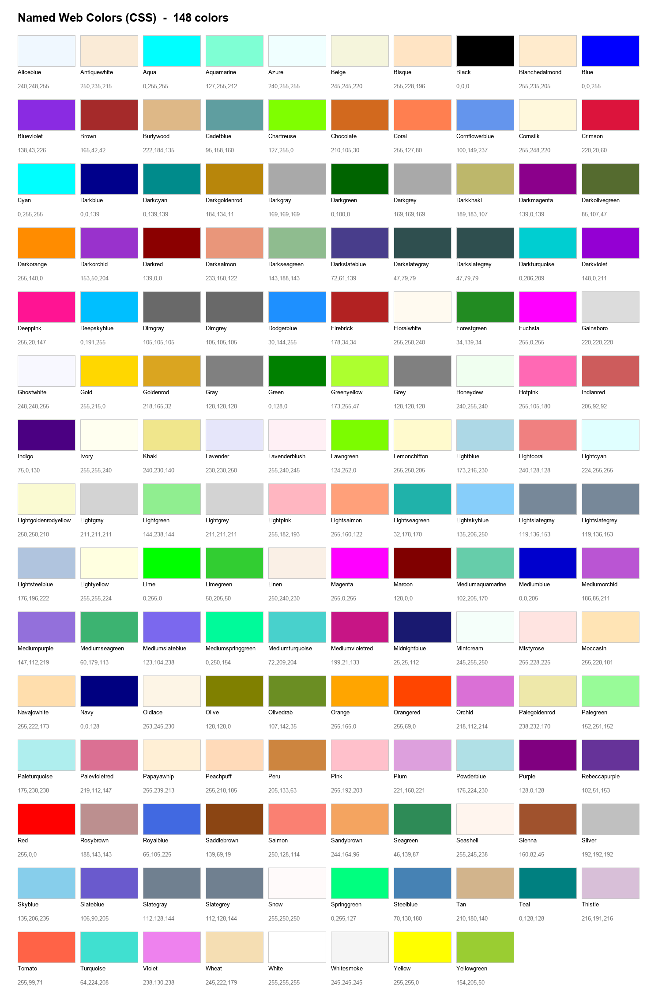
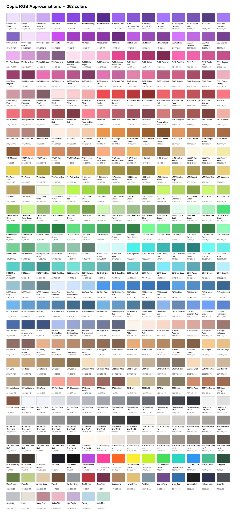

# W7k.RevitColors

Custom **Autodesk Color Books** (`.acb`) for Revit. Use them to mark things on drawings consistently: filled regions, view filters, overrides, markups and legends.

| Color book | Colors | Use it for |
|---|---|---|
| **W7k.Colors.Pastels** | 30 (3 pages) | Soft fills and background marking. You can still read linework over them. |
| **W7k.Colors.ContrastingButUgly** | 20 (2 pages) | When categories must never be confused: clashes, QA checks, temporary markups. |
| **W7k.Colors.OkabeIto** | 8 (1 page) | Color-blind safe marking: drawings and legends that colleagues or clients with color vision deficiency must read. |

### Contributed color books

Ready-made color books shared by **Michael Wolff** in a [discussion on the Autodesk Community forum](https://forums.autodesk.com/t5/revit-architecture-forum/how-many-people-on-your-project-can-t-read-your-colour-coded/td-p/14319992). Thank you, Michael!

| Color book | File | Colors |
|---|---|---|
| **Copic RGB Approximations** | `Copic_358_plus_24_RGB_Approximations.acb` | 382 |
| **Copic HEX-RGB Approximations** | `Copic_358_plus_24_HEX-RGB_Approximations.acb` | 382 (same colors, HEX code in the name) |
| **Les Couleurs Le Corbusier** | `Les_Couleurs_Le_Corbusier_French_Code.acb` | 63 |
| **Les Couleurs Le Corbusier - RGB HEX** | `Les_Couleurs_Le_Corbusier_French_Code_RGB_HEX.acb` | 63 (same colors, HEX code in the name) |
| **Named Web Colors (CSS)** | `Named_Web_Colors.acb` | 148 |
| **RAL Classic Wikipedia** | `RAL_Classic_Wikipedia.acb` | 217 |

These are on-screen RGB approximations of physical color systems (Copic markers, Le Corbusier's Polychromie architecturale, RAL Classic). Use them to get close to a reference color, not as an exact match for paint or print. The names belong to their respective owners.

## Preview

### W7k.Colors.Pastels


### W7k.Colors.ContrastingButUgly


### W7k.Colors.OkabeIto


### Contributed (by Michael Wolff)

The HEX variants contain the same colors as the books below, with the HEX code added to each name.

#### Les Couleurs Le Corbusier
<details>
<summary>Show preview (63 colors)</summary>


</details>

#### RAL Classic Wikipedia
<details>
<summary>Show preview (217 colors)</summary>


</details>

#### Named Web Colors (CSS)
<details>
<summary>Show preview (148 colors)</summary>


</details>

#### Copic RGB Approximations
<details>
<summary>Show preview (382 colors)</summary>


</details>

## Installation

### Option A: Script (recommended)

1. Clone or download this repository.
2. Open PowerShell in the repository folder and run:

   ```powershell
   .\install.ps1                      # pick the color books from a list, every Revit version found
   .\install.ps1 -All                 # install every color book, no questions
   .\install.ps1 -Books W7k.*         # only the W7k color books
   .\install.ps1 -Books RAL*,Named*   # pick by file name (wildcards allowed)
   .\install.ps1 -Year 2024           # only Revit 2024
   .\install.ps1 -Uninstall           # pick the color books to remove
   ```

   Without `-All` or `-Books`, the script shows a numbered list. Type numbers or ranges (`1,3,5-7`), `all`, or press Enter for the three W7k books.

   If you get an access error, run PowerShell **as Administrator**.

   If scripts are blocked by your execution policy, run this first, for the current session only:

   ```powershell
   Set-ExecutionPolicy -Scope Process -ExecutionPolicy Bypass
   ```

3. Restart Revit if it was open.

### Option B: Manual

Copy the `.acb` files you want from `ColorBooks\` (and `ColorBooks\Contributed\`) into:

```
C:\ProgramData\Autodesk\RVT <year>\ColorBooks\
```

For example `C:\ProgramData\Autodesk\RVT 2024\ColorBooks\`. Then restart Revit.

### Using the colors in Revit

1. Open any Revit color picker, for example a filled region's foreground color or a view filter override.
2. Click **Color Books...**.
3. Pick **W7k.Colors.Pastels**, **W7k.Colors.ContrastingButUgly**, **W7k.Colors.OkabeIto** or any other installed book from the dropdown.
4. Browse the pages with the slider. You can also type a color name to jump to it.

Every color has a code (`PM01`–`PM30`, `CU01`–`CU20`, `OI01`–`OI08`). Reference the codes in your office standards and legends instead of RGB values.

## Usage notes

- **Pastels on white sheets:** the lightest pastels (PM05 Peach Cream, PM16 Mint Cream, PM23 Baby Blue, PM28 Lilac Mist) almost disappear as thin lines. Use them for fills only. Pairs such as Seafoam/Mint Cream and Powder Blue/Slate Blue are the closest in the set, so don't give them to adjacent categories.
- **ContrastingButUgly** has no near-white (the paper) and no near-black (default linework), so every color stands out from the drawing itself.
- **OkabeIto** is the only set built for color vision deficiency. Its 8 colors are fixed by the original palette, so if you need more categories, combine them with line patterns or fill patterns instead of adding colors. OI08 Black matches default linework: keep it for fills or emphasis, not for categories drawn as thin lines. OI04 Yellow is weak as a thin line on white paper.
- **Printing:** test-plot a sheet before relying on the colors in printed sets. Plotters and B&W/greyscale PDF exports change the result.

## How the colors were chosen

Both sets were generated in the perceptual **OKLab** color space by maximizing the minimum distance between any two colors (a max-min / farthest-point selection), within limits for each set:

- **Pastels:** lightness 0.79–0.93, chroma 0.05–0.11. The closest pair is about 0.06 ΔE_ok apart.
- **ContrastingButUgly:** the full sRGB gamut, lightness 0.25–0.92. The closest pair is about 0.18 ΔE_ok apart, roughly 3× more separated than the pastels. 20 colors was chosen because adding more shrinks the minimum separation steadily.

**OkabeIto** was not generated: it is the published Okabe-Ito palette (Masataka Okabe & Kei Ito, *Color Universal Design*, 2008) with its standard RGB values, chosen to remain distinguishable under protanopia, deuteranopia and tritanopia.

## Repository structure

```
W7k.RevitColors/
├── ColorBooks/            # .acb files to install (W7k books generated)
│   └── Contributed/       # ready-made .acb files from contributors
├── palettes/              # source of truth: one JSON per W7k color book
├── previews/              # swatch sheets (generated)
│   └── Contributed/
├── tools/
│   └── build_colorbooks.py
├── install.ps1
└── README.md
```

## Editing or adding a color book

1. Edit a file in `palettes/`, or add a new one. A palette file looks like this:

   ```json
   {
     "bookName": "W7k.Colors.Something",
     "prefix": "XX",
     "pages": [{"title": "Page one"}],
     "colors": [{"name": "Red", "rgb": [255, 0, 0]}]
   }
   ```

2. Rebuild the color books and previews (needs Python 3.8+; Pillow is only needed for the previews):

   ```bash
   pip install pillow
   python tools/build_colorbooks.py
   ```

3. Re-run `install.ps1`.

To add a ready-made `.acb` instead, drop it into `ColorBooks/Contributed/` and run the build script to create its preview.

Rules from the Revit color book format: color names must be unique within a book, Revit shows at most 10 colors per page (the build script paginates automatically), and spaces in file names must be real spaces.

## Credits

- **W7k color books:** Julian Wandzilak (W7k).
- **Contributed color books** (Copic, Le Corbusier, Named Web Colors, RAL Classic): **Michael Wolff**, shared in an [Autodesk Community forum discussion](https://forums.autodesk.com/t5/revit-architecture-forum/how-many-people-on-your-project-can-t-read-your-colour-coded/td-p/14319992).
- **Okabe-Ito palette:** Masataka Okabe & Kei Ito.

## Reference

Autodesk Color Book format: *Revit API Developer's Guide → Advanced Topics → Autodesk Color Book*
https://help.autodesk.com/view/RVT/2024/ENU/?guid=Revit_API_Revit_API_Developers_Guide_Advanced_Topics_Autodesk_Color_Book_html
